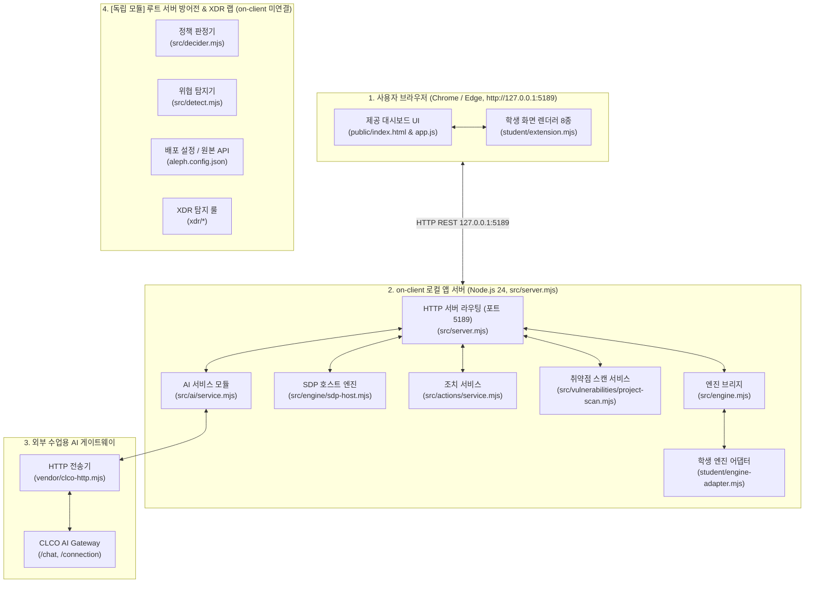

# 학생용 실행 설명서 및 시스템 구성도 (Agent: bankhar_b)

이 문서는 보안 Agent(Alekov) 프로젝트의 시스템 구성, 실행 방법, 모듈 경계, 문제 해결 절차를 제3자가 그대로 재현할 수 있도록 정리한 실행 설명서(Runbook)입니다.

---

## 1. 프로젝트 개요 및 지원 환경

- **목적**: 제로 트러스트 관점에서 사용자의 기기 보안 상태, 세션 유효성, 업무 앱 접근 인가, 보안 이벤트의 AI 근거 설명, 보안 조치 요청과 실제 연동 결과 분리, 설치 패키지의 OSV 취약점 조회 결과를 투명하게 제공합니다.
- **실행 환경 (실제 검증 완료)**:
  - 운영체제: Windows (PowerShell 5.1 / 7+)
  - Node.js: `v24.19.0` (엔진 요구 사양 충족)
  - npm: `11.17.0`
  - 외부 런타임 의존성: `on-client` 기준 순수 Node.js 내장 모듈 사용 (추가 `npm install` 불필요)

---

## 2. 프로젝트 폴더 구조

```text
sktaleph2/
├── README.md                      # 프로젝트 통합 설명서 및 단계별 이력
├── aleph.config.json              # 플랫폼 및 중앙 인증/API 설정
├── docs/                          # 프로젝트 문서
│   ├── DECIDER_REQUEST.md         # 접근 제어 요청 명세서
│   ├── DETECT_EVENTS.md           # XDR 이벤트 명세서
│   └── STUDENT_RUNBOOK.md         # [본 문서] 학생용 실행 설명서 및 구성도
├── on-client/                     # 클라이언트 보안 Agent 프로젝트
│   ├── package.json               # 클라이언트 실행 스크립트 (start, demo, check)
│   ├── public/                    # 제공 웹 UI 리소스 (HTML, CSS, JS)
│   │   ├── index.html             # 메인 대시보드 화면
│   │   ├── app.js                 # 화면 상태 관리 및 API 통신
│   │   ├── vulnerabilities-view.mjs # 취약점 정규화 및 제공 뷰
│   │   └── ai-connect.mjs         # AI 연결 설정 뷰
│   ├── src/                       # 제공 로컬 백엔드 서버
│   │   ├── server.mjs             # HTTP API 서버 (포트 5189)
│   │   ├── engine.mjs             # 로컬 보안 엔진 브리지
│   │   ├── ai/                    # AI 서비스 연동 모듈
│   │   ├── actions/               # 보안 조치 처리 모듈
│   │   └── vulnerabilities/       # OSV 취약점 대조 서비스
│   ├── student/                   # [학생 전용 구현 영역]
│   │   ├── extension.mjs          # 학생 화면 렌더링 함수 모음 (13~20단계)
│   │   └── engine-adapter.mjs     # 엔진 어댑터 구현부
│   └── tools/                     # PowerShell 시작 및 인증 보조 스크립트
│       └── start-alekov.ps1       # 로컬 Agent 실행 스크립트
├── src/                           # 루트 정책 결정 및 탐지 엔진 (decider, detect)
└── xdr/                           # 6종 위협 탐지 패턴 및 대응 규칙
```

---

## 3. 실행 절차 (Runbook)

### 3.1. PowerShell 실행 위치
저장소를 복제한 최상위 폴더(프로젝트 루트)에서 새 PowerShell 창을 열고, 상대 경로를 통해 `on-client` 디렉토리로 이동합니다:
```powershell
# 저장소를 복제한 최상위 디렉토리(루트)에서 상대 경로로 이동
cd on-client
```

### 3.2. 문법 및 구현 검사
실행 전 학생 작성 코드의 문법 오류 여부를 확인합니다:
```powershell
npm run check
```
- **정상 결과**: 아무런 오류 메시지 없이 종료 코드 0으로 완료.

### 3.3. 로컬 데모 서버 실행
예제 데이터를 포함하여 브라우저에서 대시보드를 검증할 수 있는 데모 서버를 실행합니다:
```powershell
npm run demo
```
- PowerShell 도구 사용 시:
  ```powershell
  powershell -NoProfile -ExecutionPolicy Bypass -File .\tools\start-alekov.ps1
  ```

### 3.4. 정상 시작 신호 및 브라우저 접속
- **정상 시작 콘솔 신호**:
  ```text
  [Alekov] Server listening on http://127.0.0.1:5189 (demo mode)
  ```
- **브라우저 접속 주소**: [http://127.0.0.1:5189](http://127.0.0.1:5189)

### 3.5. 서버 종료 및 재실행 순서
1. 실행 중인 PowerShell 창에서 `Ctrl + C`를 누르고, 일괄 작업을 끝내겠습니까 질문에 `Y`를 입력하여 서버를 중지합니다.
2. 재실행 시 다시 `npm run demo` 또는 `npm start`를 실행합니다.

---

## 4. 시스템 아키텍처 및 구성도



### 시스템 구성도 상세 설명
1. **사용자 브라우저 (`http://127.0.0.1:5189`)**:
   - `public/index.html`, `public/app.js`: 대시보드 레이아웃 구성, 폴링 타이머, 사용자 상호작용 처리.
   - `student/extension.mjs`: `createStudentView`를 통해 8종의 학생 영역 화면을 렌더링.
2. **on-client 로컬 앱 서버 (`on-client/src/server.mjs`)**:
   - `node:http` 기반으로 127.0.0.1:5189에 바인딩되어 정적 리소스 및 `/api/*` 엔드포인트를 제공.
   - **실제 소스코드 import 및 런타임 연결 모듈**:
     - 엔진 브리지: `on-client/src/engine.mjs` (`loadEngine`, `demoEngine`)
     - 학생 엔진 어댑터: `on-client/student/engine-adapter.mjs`
     - SDP 호스트 엔진: `on-client/src/engine/sdp-host.mjs`, `sdp-host-config.mjs`
     - 조치 서비스: `on-client/src/actions/service.mjs`, `sdp-action-engine.mjs`
     - 취약점 스캔: `on-client/src/vulnerabilities/project-scan.mjs`, `osv.mjs`
     - AI 서비스: `on-client/src/ai/service.mjs`, `vault-service.mjs`
3. **수업용 AI 게이트웨이 (CLCO AI Gateway)**:
   - `on-client/src/ai/service.mjs`가 `on-client/vendor/clco-http.mjs`를 통해 외부 게이트웨이 엔드포인트(`/chat`, `/connection`)로 Bearer 토큰 기반 요청을 전송.
4. **[독립 모듈] 루트 서버 방어전 & XDR 랩 (on-client 미연결)**:
   - 루트의 `src/decider.mjs`, `src/detect.mjs`, `xdr/*`, `aleph.config.json`은 대회 1~12단계의 독립된 서버 방어전 과제 구성요소입니다.
   - `on-client/src/server.mjs`에서는 이들을 import하거나 런타임에 호출하지 않으며, 완전히 독립된 별도 모듈로 유지됩니다.

---

## 5. 제공 코드와 학생 구현 영역 경계

| 구분 | 파일 및 경로 | 주요 역할 및 학생 구현 함수 |
|---|---|---|
| **제공 코드** | `on-client/public/*` | 메인 레이아웃(`index.html`), 전역 상태 및 타이머(`app.js`), 스타일(`style.css`) |
| **제공 코드** | `on-client/src/*` | 로컬 API 서버(`server.mjs`), SDP 호스트(`sdp-host.mjs`), OSV 스캐너(`vulnerabilities/osv.mjs`), AI 클라이언트 |
| **제공 코드** | `on-client/vendor/*` | AI 게이트웨이 HTTP 통신 전송기(`clco-http.mjs`) |
| **학생 구현** | `on-client/student/extension.mjs` | **학생 전용 렌더링 뷰 8종 모음 (`createStudentView`)**: |
| └ 13단계 | `renderIdentity` | 사용자 계정, 등록 기기 규정 준수 여부, 세션 상태를 명확히 구분하여 표시 |
| └ 14단계 | `renderDecision` | 업무 앱 인가 결과(allow/deny) 및 진단 가이드, 클립보드 진단 정보 복사 |
| └ 15단계 | `renderStatus` | 접속 모드(demo/connected/unknown), 네이티브 기기 진단 및 상태 식별 |
| └ 16단계 | `renderEvents` | 보안 기록(보안 사건 목록 및 상태별 상세 내역) 표시, 기록 오류 처리 |
| └ 17단계 | `renderAiConnection` | AI 연결 점검 상태(test/verified), 검증 시각, 등록 모델 수, 수동 재점검 안내 |
| └ 18단계 | `renderExplanation` | AI 보안 이벤트 설명, 근거(`evidenceIds`) 일치 검증, unknown 상태 명시 |
| └ 19단계 | `renderAction` | 조치 제안·확인·서버 접수(ACK)와 실제 원천 효과(`effectApplied`) 엄격 분리 |
| └ 20단계 | `renderVulnerabilities` | `package-lock.json` 설치 버전과 OSV 취약점 대조, none_found/unverifiable 구분 |
| **학생 구현** | `on-client/student/engine-adapter.mjs` | SDP 호스트 엔진과 학생 확장 모듈 간 연동 브리지 |

---

## 6. 장애 상황 및 오류별 해결 안내 (Troubleshooting)

| 화면 오류 문구 | 원인 분석 | 확인 및 해결 방법 |
|---|---|---|
| **연결 없음 (disconnected)** | `on-client`의 기본 실행(`npm start`)은 기존 회사 시스템(기존 엔진)에 연결되지 않은 **정상적인 기본 상태**임. `npm run demo`는 예제 자료를 띄우는 모드일 뿐 실제 연결을 수립하는 해결책이 아님. | 1. **기본 상태 인지**: 연결 없음은 비정상 오류가 아니라 외부 연동 설정이 없는 환경의 기본 동작임.<br/>2. **실제 연결 필요 시 확인 절차**:<br/>- 운영자가 제공한 네이티브 호스트 레지스트리 도구(`tools/native-host-registry.ps1`, `prepare-native-host.ps1`) 실행 및 브라우저 확장 등록 확인.<br/>- 운영자가 제공한 SDP 호스트 설정(`src/engine/sdp-host-config.mjs`) 및 인증 환경 변수 확인.<br/>- 학생 어댑터(`student/engine-adapter.mjs`)의 연결 설정 점검.<br/>3. **화면 렌더링 점검**: 단순히 학생 화면 동작을 테스트하려는 경우에만 `npm run demo`로 예제 데이터를 확인. |
| **권한 준비 중 / 확인 불가** | 학생 계정의 AI 서비스 또는 SDP 권한이 발급 대기 중 | 공식 대회 운영진의 계정 권한 준비를 대기합니다 (학생 임의 조작 불필요). |
| **조회 준비 미완료 (not_configured)** | 20단계 취약점 조회 대상 프로젝트 경로 미설정 | 운영자 설정 항목이며, 화면에서 안내되는 프로젝트 연결 준비 상태를 유지합니다. |
| **아직 조회 안 함 (not_checked)** | 승인된 공개 패키지 대상이 없거나 스캔 미실행 | 화면 상단의 「설치 패키지 조회」 버튼을 직접 클릭하여 조회를 트리거합니다. |
| **lock 파일 확인 불가 (unverifiable)** | `package-lock.json` 파일이 없거나 해시 검증 실패 | 프로젝트 루트에 유효한 `package-lock.json`이 존재하는지 확인합니다. |
| **서버 접수·처리 중 (pending)** | 조치 요청은 전송되었으나 원천 시스템의 효과 미확인 | 접수(ACK)는 성공이 아니므로, 제공 화면의 「결과만 재조회」 버튼을 누릅니다. |
| **요청 시간 초과 (TIMEOUT)** | AI 게이트웨이 또는 외부 OSV API 응답 지연 | 네트워크 연결 상태를 확인하고 잠시 후 수동으로 다시 요청합니다. |

---

## 7. 지원 범위 및 확인 상태

### 7.1. 실제로 확인한 기능 (로컬 검증 완료)
- Node.js 24.19.0 환경에서 `npm run check`를 통한 전체 학생 렌더링 코드 문법 통과.
- `npm run demo`를 통한 로컬 포트 5189 대시보드 정상 서빙.
- 13~20단계 단위 렌더링 함수의 상태별 DOM 구성(`createElement`, `textContent`) 및 data-* 속성 부여.
- 이전 요청의 결과 잔존(stale response) 방지 및 fresh DOM 생성 동작.

### 7.2. 기다림(UNV) 목록 (원격 및 실서버 연동 대기)
- **실제 AI 설명 모델 호출**: 대회 심판/운영 측의 실제 계정별 AI 앱 토큰 및 권한 준비 대기.
- **실제 SDP 보안 조치 원천 집행**: 운영 측 지원 조치(`supportedActions`) 활성화 및 실제 집행기 연동 대기.
- **실시간 OSV 외부 API 연동**: 프로덕션 실서버 환경에서의 실시간 쿼리 연동 (로컬에서는 규격화된 데이터로 검증).

---

## 8. 보안 수칙 준수
- 본 실행서 및 프로젝트 코드에는 API 비밀키, 베어러 토큰, 서버 전용 비밀값, 기기 개인키를 일체 기재하지 않습니다.
- 필요한 인증값은 공식 설정 화면의 안전한 볼트나 로컬 `.env` 환경을 통해서만 주입됩니다.
